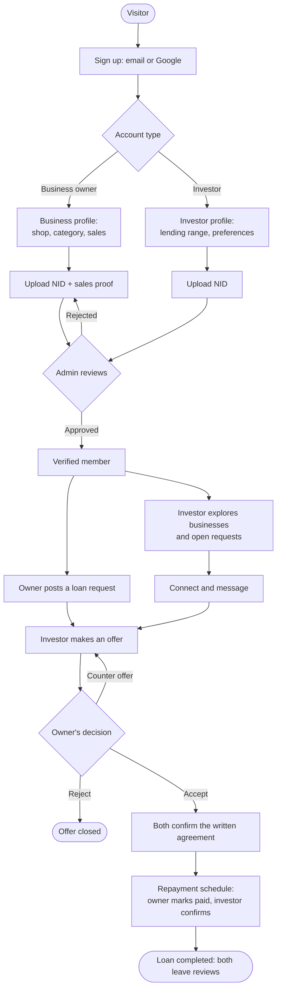

# SME Connect

**A verified network where Bangladeshi small businesses meet the investors who want to back them.**

Live prototype: https://smeconnect-fawn.vercel.app

> **Prototype notice:** SME Connect doesn't hold or move money. Loans are agreed directly
> between members; the platform verifies people, carries the conversation and keeps a
> written record of what was agreed and repaid.

---

## Problem statement

Bangladesh has a huge number of small and medium enterprises (SMEs): online shops,
farmers, bazaar and market stall holders, home kitchens and more. Most of them can't grow
because they can't get capital. When an SME needs money, it usually has three options, and
all of them are bad:

1. **Banks** charge high interest and ask for a lot of paperwork that a small shop often
   doesn't have.
2. **Informal third-party lenders** often charge very high interest without the borrower
   fully understanding it, and some are outright scams.
3. **Investor firms** rarely say yes. Investors have their own preferences about which kinds
   of business they want to back, and a small shop has no way to reach the ones who would
   be interested.

The result is a large communication gap: there is no bridge between SME owners and the
investors who might fund them, and no place for owners to build a business network.

## Solution

**SME Connect** is that bridge: a LinkedIn-style network for business owners and investors.

- Business owners find investors that suit them, and investors find the businesses they
  prefer: by category, location, loan size, tenure and trust score.
- Both sides can **connect**, **message**, and **make, counter (bargain on), accept or reject
  loan offers**.
- Every member can be **verified** (national ID, and sales proof for businesses), so people
  on both sides know they are dealing with real people in the market.
- Once both sides confirm an agreement, the repayment schedule is tracked in the app until
  the loan is fully repaid, and each side can leave a review.

## Team members

- Tausif Mushtaque
- Sanjida Akter Shorna
- Afsana Akter Mim
- MD Fahim Bin Imam Nahid
- MD. Mahadi Hasan

### Contributors in the git history

| Team member | Git author name(s) |
| --- | --- |
| Tausif Mushtaque | `Tausif Mushtaque`, `blackhashcode` |
| MD Fahim Bin Imam Nahid | `NahidWorld`, `Nahid` |
| Afsana Akter Mim | `Afsanameem0` |
| MD. Mahadi Hasan | `Md. Mahadi Hasan` |
| Sanjida Akter Shorna | — (no commits in the repository) |

Run `git shortlog -sn --all` to see the current commit counts.

---

## How the application works



Admins oversee everything: verification, reports, member accounts, posts, loan requests and
repayments, with every action recorded in an activity log.

---

## Functional requirements met

**Accounts and identity**
- Sign up and sign in with email and password (email verification code) or with Google.
- Two account types, business owner and investor, plus administrators.
- Rate-limited sign-in, admin sign-out from every device, and account suspension.

**Profiles**
- Business profiles: shop name, category, location, description, monthly sales range,
  orders per month, running since, growth story, social and shop links, product photos.
- Investor profiles: lending range, preferred categories, tenure and interest rate, bio.
- Profile photo and an optional cover photo for both account types (upload, change or remove).
- Public profile pages with trust score, lending history and reviews.

**Verification**
- Owners upload a national ID and sales proof (bKash, Nagad or bank statements); investors
  upload a national ID.
- Admins approve or reject with a note; members are notified; documents stay private.

**Discovery and networking**
- Explore businesses, investors and open loan requests with filters (category, location,
  trust score, verified only, loan amount, tenure, repayment frequency, sorting).
- Search, follow, connection requests (owners and investors, and investor to investor).
- Direct messaging between connected members.
- Home feed of updates, milestones, new loan requests and repayments, with likes and comments.
- Members can edit or delete their own posts.

**Loans**
- Owners publish a loan request (amount, purpose, tenure, rate, repayment frequency).
  Only one request can be active at a time, with a clear message explaining why.
- Investors make offers; owners can accept, reject or counter, and both sides can bargain.
- Both sides confirm a written agreement before repayments start.
- Repayment schedule: owner marks an instalment paid, investor confirms it; overdue
  instalments are flagged and reminder emails are sent automatically.
- Reviews from both sides after a loan is completed.

**Trust and safety**
- Report members, posts and comments; block members.
- In-app notifications with a notification tray and pop-ups, plus email notifications.

**Administration**
- Admin dashboard with platform statistics.
- Review verifications and reports; suspend and reactivate members; change roles.
- Edit any member's profile, and edit, remove or restore any post or comment.
- Pause, resume, cancel or reopen loan requests; confirm instalments on an investor's behalf.
- Full activity log of member and admin actions.

---

## Tech stack

| Layer | Technology |
| --- | --- |
| Frontend | Next.js 16 (App Router), React 19, TypeScript, Tailwind CSS 3, Lucide icons |
| Backend API | Next.js 16 route handlers (`/api/v1`), TypeScript, Zod validation, OpenAPI documentation |
| Authentication | Better Auth (email and password with verification codes, Google OAuth) |
| Database | PostgreSQL, accessed with Prisma ORM 7 |
| Database hosting | Neon (serverless Postgres, Singapore region) |
| Website hosting | Vercel (frontend and backend as one project, Singapore region) |
| Email | Brevo SMTP in production, Mailpit locally (via Nodemailer) |
| File storage | Uploaded files stored in Postgres behind access rules (local disk in development) |
| Scheduled jobs and CI | GitHub Actions (checks on every push, daily repayment reminder and overdue jobs) |
| Testing | Vitest unit and service tests, an end-to-end smoke test, a bot-user load test |
| Local tooling | Docker Compose (Postgres and Mailpit), pnpm (backend), npm (frontend) |

---

## Repository layout

```
SMEconnect/
├── frontend/                 Next.js web app (pages and UI only)
│   ├── public/images/        Photos used on the site
│   └── src/
│       ├── app/              Pages: (public) landing, login, signup; (app) feed, explore,
│       │                     profiles, loans, messages, notifications, dashboards, admin
│       ├── components/       UI building blocks: ui, layout, auth, domain, social, admin
│       ├── lib/              API client, session, formatting and helpers
│       └── data/             Shared types and static lists
├── backend/                  Next.js API under /api/v1
│   ├── prisma/               Database schema, migrations and the admin seed
│   ├── src/app/api/          Route handlers (auth, profiles, loans, posts, admin, ...)
│   ├── src/server/           Services, validators, auth, storage, notifications, OpenAPI
│   ├── src/jobs/             Repayment reminder and overdue jobs
│   ├── scripts/              Smoke test and bot-user load test
│   ├── docs/                 API.md, DATABASE.md, USER_FLOWS.md
│   └── docker-compose.yml    Local Postgres and Mailpit
├── docs/
│   ├── QA_REPORT.md          Findings, fixes and test results
│   ├── PERFORMANCE_TEST.md   Load test and what it changed
│   ├── DEPLOYMENT.md         Hosting walkthrough (Vercel and Neon)
│   └── GOOGLE_AUTH.md        Setting up "Continue with Google"
├── .github/workflows/        CI and scheduled repayment jobs
└── vercel.json               Vercel setup (frontend and backend services)
```

The browser only talks to the frontend; the frontend forwards `/api/v1/*` to the backend,
so the sign-in cookie stays first-party.

---

## Run it locally

**You need:** Node.js 22.12 or newer, pnpm (`npm i -g pnpm`) and Docker Desktop.

**1. Start the backend** (API on http://localhost:4000)

```bash
cd backend
cp .env.example .env      # then set BETTER_AUTH_SECRET, ADMIN_EMAIL and ADMIN_PASSWORD
docker compose up -d      # Postgres + Mailpit (test inbox at http://localhost:8025)
pnpm install
pnpm db:migrate           # create the database tables
pnpm db:seed              # create the admin account from your .env
pnpm dev
```

Generate a `BETTER_AUTH_SECRET` with `openssl rand -base64 32`. The admin password must be
at least 12 characters.

**2. Start the frontend** in a second terminal (http://localhost:3000)

```bash
cd frontend
cp .env.example .env.local
npm ci
npm run dev
```

**3. Try it**

- Open http://localhost:3000/signup and create a business owner and an investor (use two
  different browsers or a private window). Verification codes arrive in Mailpit at
  http://localhost:8025.
- Sign in as the admin from your `.env` to approve verifications and see the admin panel.
- Want lots of test members at once? Run `pnpm bots` in `backend`.

**4. Run the checks** (optional)

| Where | Command | What it checks |
| --- | --- | --- |
| backend | `pnpm typecheck && pnpm lint && pnpm test` | Types, linting, unit and service tests |
| backend | `pnpm smoke` | The full member journey against the running API |
| frontend | `npm run typecheck && npm run build` | Types and production build |

Google sign-in is optional locally; see [docs/GOOGLE_AUTH.md](docs/GOOGLE_AUTH.md). To put
your own copy online, follow [docs/DEPLOYMENT.md](docs/DEPLOYMENT.md).

---

## Security

Secrets are never committed. `.env` and `.env.*` files, keys and credential files are
ignored by git; only `.env.example` files with placeholder values are in the repository.
