# SME Connect database design

Phase 1 data model for SME Connect. The backend rules in `AGENTS.md` and
`BACKEND_PROMPT.md` are authoritative. The frontend stand-in contract on
`origin/main` uses different status/role names and is **not** used as the
database source of truth.

- Engine: PostgreSQL 16
- ORM: Prisma 7.10.1 (`prisma-client` generator, generated at `src/generated/prisma`)
- Validation: Zod 4 schemas in `src/server/validators/`
- Money: whole-taka `Int` BDT values in fields ending in `Bdt`
- Rates: `Decimal(5,2)` in fields ending in `Pct`

## Entities

| Area | Entities |
|---|---|
| Auth | `User`, `Session`, `Account`, `Verification` |
| Credibility | `UserVerification` |
| Profiles | `BusinessProfile`, `ProductImage`, `InvestorProfile` |
| Lending | `LoanRequest`, `Offer`, `Loan`, `Agreement`, `Repayment` |
| Feed & networking | `Post`, `Comment`, `Like`, `Follow`, `Connection`, `Conversation`, `Message`, `MessageDeletion` |
| Reputation & admin | `Notification`, `Review`, `Report`, `Block` |

## ER diagram

```mermaid
erDiagram
  USER ||--o{ SESSION : has
  USER ||--o{ ACCOUNT : has

  USER ||--o{ USER_VERIFICATION : submits
  USER o|--o{ USER_VERIFICATION : reviews

  USER ||--o| BUSINESS_PROFILE : owns
  BUSINESS_PROFILE ||--o{ PRODUCT_IMAGE : has

  USER ||--o| INVESTOR_PROFILE : has

  USER ||--o{ LOAN_REQUEST : publishes
  LOAN_REQUEST ||--o{ OFFER : receives
  USER ||--o{ OFFER : makes
  OFFER ||--o{ OFFER : counters

  LOAN_REQUEST ||--o| LOAN : funded_by
  OFFER ||--o| LOAN : accepted_as
  USER ||--o{ LOAN : owns
  USER ||--o{ LOAN : invests_in
  LOAN ||--o| AGREEMENT : has
  LOAN ||--o{ REPAYMENT : schedules

  USER ||--o{ POST : authors
  LOAN_REQUEST o|--o{ POST : generates
  POST ||--o{ COMMENT : has
  USER ||--o{ COMMENT : writes
  POST ||--o{ LIKE : receives
  USER ||--o{ LIKE : gives

  USER ||--o{ FOLLOW : follows
  USER ||--o{ FOLLOW : is_followed_by
  USER ||--o{ CONNECTION : requests
  USER ||--o{ CONNECTION : receives

  USER ||--o{ CONVERSATION : participant_one
  USER ||--o{ CONVERSATION : participant_two
  CONVERSATION ||--o{ MESSAGE : contains
  USER ||--o{ MESSAGE : sends
  MESSAGE ||--o{ MESSAGE_DELETION : hidden_by
  USER ||--o{ MESSAGE_DELETION : hides

  USER ||--o{ NOTIFICATION : receives

  LOAN ||--o{ REVIEW : has
  USER ||--o{ REVIEW : writes
  USER ||--o{ REVIEW : receives

  USER ||--o{ REPORT : files
  USER o|--o{ REPORT : handles
  USER ||--o{ BLOCK : blocks
  USER ||--o{ BLOCK : is_blocked_by

  AUTH_VERIFICATION {
    string id PK
    string identifier
    string value
    datetime expiresAt
    datetime createdAt
    datetime updatedAt
  }

  USER {
    string id PK
    string name
    string email UK
    string phone UK "optional"
    boolean phoneVerified
    string image "avatar URL"
    Role role
    UserStatus status
    datetime createdAt
    datetime updatedAt
  }

  SESSION {
    string id PK
    string token UK
    datetime expiresAt
    string ipAddress "optional"
    string userAgent "optional"
    string userId FK
    datetime createdAt
    datetime updatedAt
  }

  ACCOUNT {
    string id PK
    string accountId
    string providerId
    string userId FK
    string password "hashed by Better Auth"
    datetime createdAt
    datetime updatedAt
  }

  USER_VERIFICATION {
    string id PK
    string userId FK
    VerificationType type
    VerificationStatus status
    string idDocumentUrl "private"
    string salesProofUrls "text array"
    string shopLinks "text array"
    string reviewerId FK "optional admin"
    string reviewNote "optional"
    datetime submittedAt
    datetime reviewedAt "optional"
    datetime createdAt
    datetime updatedAt
  }

  BUSINESS_PROFILE {
    string id PK
    string ownerId FK "unique"
    string shopName
    string slug UK
    string category
    string description "optional"
    string district
    string city
    string facebookUrl "optional"
    string instagramUrl "optional"
    string whatsappUrl "optional"
    string websiteUrl "optional"
    datetime runningSince "optional"
    string monthlyOrdersRange "optional"
    int monthlySalesMinBdt "optional"
    int monthlySalesMaxBdt "optional"
    string growthStory "optional"
    string logoUrl "optional"
    string coverUrl "optional"
    int trustScore
    datetime createdAt
    datetime updatedAt
  }

  PRODUCT_IMAGE {
    string id PK
    string businessProfileId FK
    string url
    string caption "optional"
    int position
    datetime createdAt
    datetime updatedAt
  }

  INVESTOR_PROFILE {
    string id PK
    string userId FK "unique"
    string bio "optional"
    int minLendBdt
    int maxLendBdt
    string preferredCategories "text array"
    int preferredTenureDays "optional"
    decimal preferredRatePctMin "Decimal(5,2)"
    decimal preferredRatePctMax "Decimal(5,2)"
    string district "optional"
    string city "optional"
    int trustScore
    datetime createdAt
    datetime updatedAt
  }

  LOAN_REQUEST {
    string id PK
    string ownerId FK
    int amountBdt
    string purpose
    string fundUsage
    int tenureDays
    RepaymentFrequency repaymentFrequency
    decimal proposedRatePct "Decimal(5,2)"
    string proofUrls "text array"
    LoanRequestStatus status
    datetime publishedAt "optional"
    datetime createdAt
    datetime updatedAt
  }

  OFFER {
    string id PK
    string loanRequestId FK
    string investorId FK
    int amountBdt
    decimal interestRatePct "Decimal(5,2)"
    int tenureDays
    RepaymentFrequency repaymentFrequency
    string message "optional"
    OfferStatus status
    string parentOfferId FK "optional counter-offer"
    OfferProposer proposedBy
    datetime expiresAt
    datetime createdAt
    datetime updatedAt
  }

  LOAN {
    string id PK
    string loanRequestId FK "unique"
    string offerId FK "unique"
    string ownerId FK
    string investorId FK
    int principalBdt
    decimal interestRatePct "Decimal(5,2)"
    int tenureDays
    RepaymentFrequency repaymentFrequency
    int totalRepayableBdt
    LoanStatus status
    datetime startDate "optional"
    datetime createdAt
    datetime updatedAt
  }

  AGREEMENT {
    string id PK
    string loanId FK "unique"
    json termsSnapshot
    datetime ownerConfirmedAt "optional"
    datetime investorConfirmedAt "optional"
    datetime createdAt
    datetime updatedAt
  }

  REPAYMENT {
    string id PK
    string loanId FK
    int installmentNo
    datetime dueDate
    int amountBdt
    RepaymentStatus status
    datetime markedPaidAt "optional"
    datetime confirmedAt "optional"
    string note "optional"
    string proofUrl "optional"
    datetime createdAt
    datetime updatedAt
  }

  POST {
    string id PK
    string authorId FK
    PostType type
    string content
    string imageUrls "text array"
    string loanRequestId FK "optional"
    datetime deletedAt "optional"
    datetime createdAt
    datetime updatedAt
  }

  COMMENT {
    string id PK
    string postId FK
    string authorId FK
    string content
    datetime deletedAt "optional"
    datetime createdAt
    datetime updatedAt
  }

  LIKE {
    string id PK
    string postId FK
    string userId FK
    datetime createdAt
    datetime updatedAt
  }

  FOLLOW {
    string id PK
    string followerId FK
    string followeeId FK
    datetime createdAt
    datetime updatedAt
  }

  CONNECTION {
    string id PK
    string requesterId FK
    string addresseeId FK
    ConnectionStatus status
    string message "optional"
    datetime createdAt
    datetime updatedAt
  }

  CONVERSATION {
    string id PK
    string participantOneId FK
    string participantTwoId FK
    datetime createdAt
    datetime updatedAt
  }

  MESSAGE {
    string id PK
    string conversationId FK
    string senderId FK
    string body
    datetime readAt "optional"
    datetime deletedAt "optional global"
    datetime createdAt
    datetime updatedAt
  }

  MESSAGE_DELETION {
    string id PK
    string messageId FK
    string userId FK
    datetime deletedAt
    datetime createdAt
    datetime updatedAt
  }

  NOTIFICATION {
    string id PK
    string userId FK
    NotificationType type
    string title
    string body
    string link "optional"
    json data "optional"
    datetime readAt "optional"
    datetime createdAt
    datetime updatedAt
  }

  REVIEW {
    string id PK
    string loanId FK
    string reviewerId FK
    string revieweeId FK
    int rating "1-5"
    string comment "optional"
    datetime createdAt
    datetime updatedAt
  }

  REPORT {
    string id PK
    string reporterId FK
    ReportTargetType targetType
    string targetId "polymorphic"
    string reason
    ReportStatus status
    string resolutionNote "optional"
    string handledById FK "optional admin"
    datetime createdAt
    datetime updatedAt
  }

  BLOCK {
    string id PK
    string blockerId FK
    string blockedId FK
    datetime createdAt
    datetime updatedAt
  }
```

## Schema decisions

### Better Auth integration

- Core tables keep the Better Auth names `user`, `session`, `account`, `verification`.
- `User.image` is the avatar URL; no duplicate `avatarUrl` column was added.
- `role` stays server-owned in Better Auth (`input: false`). The database uses the
  `Role` enum, with `ADMIN` available only through seed/script creation.
- Domain verification is `UserVerification`; it is not mixed with Better Auth's
  short-lived `Verification` table.

### Numeric and enum rules

- Money fields are `Int` BDT. `MAX_BDT` in `src/server/validators/common.ts`
  is the PostgreSQL `INTEGER` upper bound.
- Rates are `Decimal @db.Decimal(5,2)` and normalized by `ratePctSchema` to
  strings such as `"14.50"` before reaching Prisma.
- Status/type/role fields use PostgreSQL native enums via Prisma `enum` blocks.
- `trustScore` is an `Int` constrained by service logic to 0–100.

### Naming deviations

- `monthlySalesRangeBdt` was split into `monthlySalesMinBdt` and
  `monthlySalesMaxBdt` so money stays integer and range parsing is not needed.
- Free-form `location` was split into `district` and `city` for consistent
  business/investor discovery.
- `MessageDeletion` was added so each participant can soft-delete their own
  view of a message, as required by Phase 6.
- `order` was named `position` on `ProductImage`.

### Delete behavior

- `CASCADE` for owned social/auth children: sessions, accounts, product images,
  repayments, comments, likes, follows, connections, conversations, messages,
  message deletions, notifications.
- `RESTRICT` for financial participants: loan requests, offers, loans, reviews.
- `SET NULL` for optional reviewer/handler/post links so history is preserved.

### Constraints and indexes

Unique constraints cover emails, phone numbers, profile owner/user links,
slug, one image position per business, one repayment number per loan, likes,
follows, connections, conversation pairs, reviews per loan side, reports and
blocks.

Partial unique indexes (Prisma `partialIndexes` preview feature):

- `loan_request_one_active_per_owner` — one request in
  `OPEN | IN_DISCUSSION | FUNDED | REPAYING` per owner.
- `offer_one_pending_per_investor_per_request` — one `PENDING` offer per
  investor per request.

Raw `CHECK` constraints in the migration (Prisma 7 cannot express these in
`schema.prisma`):

- rating between 1 and 5
- positive loan/offer/repayment amounts; positive principal and total repayable
- rate ranges 0–100 on requests, offers and loans
- monthly sales range and investor lending/rate ranges
- no self-follow, self-connection or self-block
- ordered conversation participants

These checks are mirrored by the Zod validators. They are intentionally not
visible to Prisma introspection; any future schema change must preserve them.

## Transaction notes

The schema supports the Phase 7/8 multi-table transactions:

- accepting an offer: offer states, request state, `Loan` and `Agreement`
- confirming an agreement: confirmations, repayment schedule, request/loan states
- recording repayment: owner mark-paid and investor confirmation
- completing a loan: all repayments, loan and request status, reviews

Services will wrap these operations in `prisma.$transaction`.

## Migration

- Migration: `prisma/migrations/20261123170000_init`
- Generated with `prisma migrate diff --from-empty --to-schema ... --script`
- Status: **generated and reviewed, not applied** (per Phase 1 approval)
- Apply later with `pnpm prisma migrate dev` or `pnpm prisma migrate deploy`

The migration was also applied to a temporary database
(`smeconnect_migration_check`) for verification, then that database was
dropped. The development database (`smeconnect`) was not modified.

Verification in the temporary database:

| Check | Result |
|---|---|
| Tables | 25 |
| Enums | 15 |
| Foreign keys | 41 |
| Indexes | 84 |
| Custom CHECK constraints | 16 |
| Partial unique indexes present | 2 |

`pnpm prisma migrate status` reports `20261123170000_init` as not yet applied.

## Remaining issues

- No auth/business endpoints were added in Phase 1.
- No mock/seed data was added; Phase 11 owns `prisma/seed.ts`.
- The development database still needs the initial migration applied after
  explicit approval.
- No shadow database URL is configured in `prisma7.config.ts`; `prisma migrate dev`
  can create one locally because the Docker Postgres user is a superuser. A
  hosted environment may need `shadowDatabaseUrl` configured.
