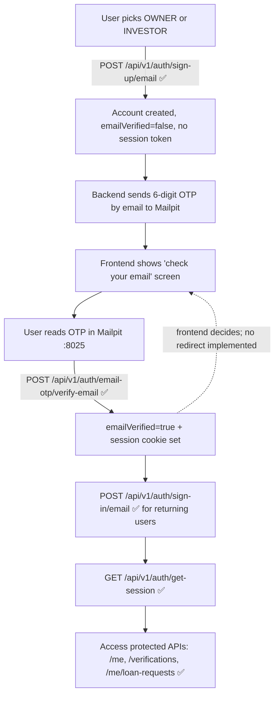

# SME Connect — user & business flows

This document describes the **actual API sequence** implemented in the backend so far.
It is written from the code, `docs/API.md` and the implementation reports in
[docs/implementation/](./implementation/README.md).

Legend:

- ✅ **Implemented** — endpoint exists and is documented in `docs/API.md` / OpenAPI.
- 🧭 **Planned** — described in `BACKEND_PROMPT.md` for a later phase; **not implemented**.
  No planned endpoint below should be treated as callable.

Scope: Phases 0–6 (setup, data model, auth/verification/storage, profiles, loan requests,
feed/networking/discovery, conversations/messaging) are implemented. Phases 7–11 are not.

> **Frontend status:** the repository's `frontend/` app talks to a stand-in mock API at
> `http://localhost:4000` (`frontend/src/lib/api.ts`), and no frontend code calls the backend
> auth endpoints. Therefore **no automatic redirect from signup to verification exists**.
> Navigation between steps is the frontend's responsibility and must be driven by API
> responses. This document does not claim any redirect that has not been implemented.

## At a glance: signup → email OTP → verification → login



Canonical sequence:

**Sign up → Receive OTP by email → Verify OTP → Sign in → Access protected APIs**

Note: `/verify-email` itself sets a session cookie (`autoSignInAfterVerification: true`), so
a freshly verified user already has a valid session. Sign-in is still the normal entry path
for returning users, and is the step the frontend should perform when no session exists.

---

## A. Signup and email verification ✅

### Step 1 — Choose a role and submit signup

`POST /api/v1/auth/sign-up/email` (public; Better Auth native JSON, not `{ data }`).

```json
{
  "name": "Shamima Akter",
  "email": "owner@example.com",
  "password": "example-password",
  "signupRole": "OWNER"
}
```

- `signupRole` is **required** and accepts only `OWNER` or `INVESTOR`. `ADMIN` is rejected.
- Client-supplied `role`, `status` or `signupRole` cannot become the stored role/status: a
  request hook maps `signupRole` onto the server-owned `role` column and strips the others.
- Password must be 8–128 characters.
- Successful response contains **no session token** (`requireEmailVerification: true`):

```json
{
  "token": null,
  "user": {
    "id": "usr_123",
    "name": "Shamima Akter",
    "email": "owner@example.com",
    "emailVerified": false,
    "role": "OWNER",
    "status": "ACTIVE"
  }
}
```

### Step 2 — Backend sends the OTP email

Signup triggers an email automatically (`emailVerification.sendOnSignUp: true` plus the
email-OTP plugin override). The message subject is **"Verify your SME Connect email"** and
contains a six-digit code that expires in **5 minutes (300 seconds)**. Locally, email is
delivered to Mailpit: UI `http://localhost:8025`, SMTP `localhost:1025`.

The frontend must tell the user to check their email — the backend does not redirect anyone.

### Step 3 — User retrieves the OTP

The user copies the six digits from Mailpit. The OTP is never logged by the backend and is
stored hashed by Better Auth.

### Step 4 — Verify the OTP

`POST /api/v1/auth/email-otp/verify-email` (public).

```json
{ "email": "owner@example.com", "otp": "123456" }
```

Success (`emailVerified: true`, session cookie `better-auth.session_token` set):

```json
{
  "status": true,
  "token": "session-token-value",
  "user": { "id": "usr_123", "email": "owner@example.com", "emailVerified": true }
}
```

Clients should rely on the httpOnly cookie, not persist the returned token in JavaScript.

### OTP problems and resending

| Situation | Behaviour | What the client should do |
|---|---|---|
| Wrong code | Better Auth returns an "Invalid OTP" error; attempts are counted (max 3) | Ask the user to re-check, or request a new code |
| Too many wrong attempts | "Too many attempts" after 3 failures | Request a fresh code with the send endpoint |
| Expired code | "OTP expired" after 300 seconds | Request a fresh code |
| Need to resend | `POST /api/v1/auth/email-otp/send-verification-otp` with `{ "email": "owner@example.com", "type": "email-verification" }` → `{ "success": true }` | The new code rotates/invalidates the previous one; rate limit is 3 requests per 60 seconds |
| Sign-in before verification | Better Auth rejects with `FORBIDDEN` / `EMAIL_NOT_VERIFIED` | Complete step 4 first |

The send endpoint returns `{ "success": true }` even for an unknown email, so it does not
disclose whether an account exists.

### Signup/verification are separate operations

There is no single "signup and verify" call. The frontend owns the navigation:
`sign-up/email` → "check your email" screen → `email-otp/verify-email` → sign-in or
protected API calls, based on the responses above. Password reset is a separate OTP flow:
`POST /api/v1/auth/email-otp/request-password-reset` then
`POST /api/v1/auth/email-otp/reset-password`.

---

## B. Login and session workflow ✅

| Step | Endpoint | Notes |
|---|---|---|
| Sign in | `POST /api/v1/auth/sign-in/email` | `{ "email": "...", "password": "...", "rememberMe": true }` |
| Check session | `GET /api/v1/auth/get-session` | Returns `{ session, user }` or `null` |
| Sign out | `POST /api/v1/auth/sign-out` | Deletes the session and clears the cookie; returns `{ "success": true }` |
| Protected access | any `/api/v1/me*`, `/api/v1/verifications*`, `/api/v1/admin*`, `/api/v1/uploads*`, `/api/v1/phone-otp*`, `/api/v1/files/private/*` | Requires the session cookie |

- Sign-in sets the httpOnly cookie `better-auth.session_token`. Sessions last **7 days** and
  refresh after **1 day**; cookie caching is disabled so role/status are always fresh.
- `src/proxy.ts` is only an optimistic prefilter: it rejects a missing cookie with 401 before
  a route runs, but a **present cookie is not trusted**. Every protected route re-checks the
  real session and role/ownership.
- When a session expires or is signed out, `get-session` returns `null` and protected APIs
  return 401 `UNAUTHORIZED` (or the proxy's 401 before reaching the route). The user signs in
  again.
- `POST /api/v1/auth/update-user` can change only `name` and `image`; role/status changes are
  stripped server-side.

---

## C. User profile workflow ✅

### Current user

- `GET /api/v1/me` → `{ data: { user, profile, verification, unread } }`.
  `profile` is the OWNER's `BusinessProfile` or the INVESTOR's `InvestorProfile`, `null` if
  not created. `verification` is `{ type, status }` or `null`. ADMINs get null profile and
  verification.
- `PATCH /api/v1/me` → accepts only `name`, `image` and an optional role-appropriate
  `profile`. Account and profile writes happen in one transaction.

OWNER example:

```json
{
  "name": "Nusrat Akter",
  "profile": {
    "shopName": "Nusrat's Home Kitchen",
    "slug": "nusrat-home-kitchen",
    "category": "Food",
    "district": "Dhaka",
    "city": "Dhanmondi",
    "logoUrl": "/api/v1/files/public/2f8c1a54-6b7d-4c9e-9f31-0a2b3c4d5e6f.jpg"
  }
}
```

INVESTOR example:

```json
{
  "profile": {
    "minLendBdt": 20000,
    "maxLendBdt": 100000,
    "preferredCategories": ["Food", "Handicrafts"],
    "preferredTenureDays": 90,
    "preferredRatePctMin": "10.00",
    "preferredRatePctMax": "16.00",
    "district": "Dhaka"
  }
}
```

Server-controlled keys (`userId`, `ownerId`, `role`, `status`, `trustScore`, verification
fields) are rejected. A missing profile needs the full create payload; an existing profile
accepts partial updates. A duplicate `slug` returns 409. Phone changes are not made here —
use the phone OTP flow below.

### Images and public profile

1. `POST /api/v1/uploads` with multipart `purpose=AVATAR` or `PRODUCT_IMAGE` and the file.
   Response contains a public URL such as `/api/v1/files/public/<uuid>.jpg`.
2. Use that URL in `PATCH /api/v1/me` (`image`, `logoUrl`, `coverUrl`) or in
   `POST /api/v1/me/product-images` (OWNER only).
3. `PATCH` / `DELETE /api/v1/me/product-images/{id}` edit/remove product images. Positions
   are auto-appended when omitted; duplicate positions return 409.
4. `GET /api/v1/profiles/{userId}` is public and returns
   `{ data: { name, image, role, verified, profile } }`. It returns 404 for a missing,
   suspended or ADMIN user, or one without a profile. No email, phone, internal IDs,
   verification records or review notes are exposed.

Public lookup is by **userId**, not by slug. Active loan requests, repayment history and
reviews are **not** yet part of the public profile (Phases 4/9 scope).

---

## D. Verification workflow ✅

Three different things are called "verification" — keep them distinct:

| Concept | Stored in | Endpoint(s) | Effect |
|---|---|---|---|
| **Email verification** | `User.emailVerified` (Better Auth) | `/api/v1/auth/email-otp/*` | Allows sign-in; enables a session |
| **Phone verification** | `User.phone`, `User.phoneVerified`, `Verification` (OTP challenge) | `/api/v1/phone-otp/request`, `/verify` | Links a phone number to the account |
| **Identity/business verification (KYC)** | `UserVerification` | `/api/v1/verifications*`, `/api/v1/admin/verifications*` | Produces the Verified badge and gates lending actions |

### Phone OTP (optional, authenticated)

```json
// POST /api/v1/phone-otp/request
{ "phone": "01712345678" }
```
```json
// POST /api/v1/phone-otp/verify
{ "phone": "01712345678", "otp": "123456" }
```

Six digits, 5-minute expiry, 3 attempts, resend cooldown 60 seconds (429 with
`details.retryAfterSeconds`). Locally the OTP is emailed to the account address through
Mailpit, or delivery metadata is printed if `OTP_DELIVERY_PROVIDER=console`. The code is
HMAC-hashed and never logged.

### Identity/business verification (KYC)

```mermaid
flowchart LR
    A[Upload ID + sales proof via POST /api/v1/uploads purpose=ID_DOCUMENT/SALES_PROOF] --> B[POST /api/v1/verifications]
    B --> C[status=PENDING]
    C --> D[ADMIN: GET /api/v1/admin/verifications]
    D --> E[ADMIN: POST /api/v1/admin/verifications/{id}]
    E -->|APPROVED| F[Verified badge + gated actions unlocked]
    E -->|REJECTED + reviewNote| G[User may resubmit]
    G --> B
```

- Submission requires a session; the actor's role decides the type (OWNER/INVESTOR). A
  mismatched `type` or an ADMIN submission returns 403.
- Documents must be **internal private upload URLs** from `/api/v1/uploads`; external/public
  URLs are rejected. Owners need at least one sales proof; investors need only an ID document.
- `GET /api/v1/verifications/me` returns the own record or `data: null`.
- Admin review: `POST /api/v1/admin/verifications/{id}` with
  `{ "status": "APPROVED", "reviewNote": "Documents checked" }`. Rejection requires a note.
  The decision and a `VERIFICATION_RESULT` notification are written in one transaction.
- A pending or approved verification cannot be resubmitted (409); a rejected one is replaced
  and reset to `PENDING`.

**Actions that require APPROVED verification today:** publishing and resuming a loan request
(Phase 4). Verification submission itself is available to unverified users. Public profiles
and public loan requests show only a derived `verified: true` boolean — no documents, status
history or review notes.

---

## E. Loan request workflow ✅ (Phase 4)

### Prerequisites for OWNER actions

| Requirement | Applies to | Failure |
|---|---|---|
| Valid Better Auth session cookie (`better-auth.session_token`) and `OWNER` role | Every `/api/v1/me/loan-requests*` call | 401 (missing/expired session), 403 (INVESTOR/ADMIN) |
| **APPROVED** OWNER identity/business verification | `publish`, `resume` | 403 `FORBIDDEN` |
| Complete business profile (`shopName`, `slug`, `category`, `district`, `city`) | `publish`, `resume` | 422 `BUSINESS_RULE_VIOLATION` |
| No other request in OPEN / IN_DISCUSSION / FUNDED / REPAYING | `publish`, `resume` | 422 `BUSINESS_RULE_VIOLATION` |

A draft can be created and edited before verification. Verification submission and profile
setup are separate flows (sections D and C). The owner id is always taken from the session —
clients never send it. Public discovery needs **no** session.

```mermaid
flowchart TD
    A[OWNER: POST /api/v1/me/loan-requests] --> B[DRAFT]
    B -->|PATCH /{id}| B
    B -->|POST /{id}/publish| C[OPEN + feed post]
    B -->|POST /{id}/cancel| X[CANCELLED]
    C -->|GET /api/v1/loan-requests/{id}| P[Public detail]
    C -->|POST /{id}/pause| D[PAUSED + post hidden]
    C -->|POST /{id}/cancel| X
    D -->|PATCH /{id}| D
    D -->|POST /{id}/resume| C
    D -->|POST /{id}/cancel| X
    C -.->|first offer: Phase 7, not implemented| I[IN_DISCUSSION]
```

In the diagram, `/{id}` and its suffixes are shorthand for `/api/v1/me/loan-requests/{id}`;
full paths are used in the steps below.

1. **Create a draft** — `POST /api/v1/me/loan-requests` (OWNER session):

```json
{
  "amountBdt": 50000,
  "purpose": "Buy a second oven",
  "fundUsage": "Expand weekend meal prep capacity",
  "tenureDays": 90,
  "repaymentFrequency": "WEEKLY",
  "proposedRatePct": "14.5",
  "proofUrls": []
}
```

Success — `201 Created` with the full owner view (`status: "DRAFT"`, `publishedAt: null`).
`ownerId`, `status`, `publishedAt` and `trustScore` cannot be supplied and are never accepted
by the strict Zod input schema:

```json
{
  "data": {
    "id": "lr_123",
    "amountBdt": 50000,
    "purpose": "Buy a second oven",
    "fundUsage": "Expand weekend meal prep capacity",
    "tenureDays": 90,
    "repaymentFrequency": "WEEKLY",
    "proposedRatePct": "14.50",
    "proofUrls": [],
    "status": "DRAFT",
    "publishedAt": null,
    "createdAt": "2026-11-23T18:00:00.000Z",
    "updatedAt": "2026-11-23T18:00:00.000Z"
  }
}
```

2. **Edit** — `PATCH /api/v1/me/loan-requests/{id}` with any subset of the same fields.
   Success is `200 OK` with the same owner view. Only DRAFT and PAUSED requests are editable;
   any other status returns 409 `CONFLICT`.

3. **Publish** — `POST /api/v1/me/loan-requests/{id}/publish` (DRAFT → OPEN). Requires an
   APPROVED OWNER verification (403), a complete business profile and no other active
   request (422). Sets `publishedAt` and creates a `LOAN_REQUEST` feed post in one
   transaction. Success is `200 OK` with the same owner view, now `status: "OPEN"` and a
   non-null `publishedAt`. Typical failures use the standard error envelope:

```json
{
  "error": {
    "code": "BUSINESS_RULE_VIOLATION",
    "message": "You already have an active loan request",
    "details": { "field": "ownerId" }
  }
}
```

4. **Discover** — `GET /api/v1/loan-requests?limit=20&sort=newest&category=Food` (public):
   returns `200 OK` with OPEN requests only, e.g.:

```json
{
  "data": [{
    "id": "lr_123",
    "amountBdt": 50000,
    "purpose": "Buy a second oven",
    "fundUsage": "Expand weekend meal prep capacity",
    "tenureDays": 90,
    "repaymentFrequency": "WEEKLY",
    "proposedRatePct": "14.50",
    "publishedAt": "2026-11-23T18:30:00.000Z",
    "createdAt": "2026-11-23T18:00:00.000Z",
    "owner": {
      "name": "Nusrat Akter",
      "image": null,
      "shopName": "Nusrat's Home Kitchen",
      "slug": "nusrat-home-kitchen",
      "category": "Food",
      "district": "Dhaka",
      "city": "Dhanmondi",
      "logoUrl": null,
      "trustScore": 80,
      "verified": true
    }
  }],
  "meta": { "limit": 20, "nextCursor": null, "hasMore": false }
}
```

Filters: `category`, `district`, `minAmountBdt`, `maxAmountBdt`, `maxTenureDays`,
`frequency`, `sort` (`newest` | `amountAsc` | `amountDesc`); inverted amount ranges return
400. `GET /api/v1/loan-requests/{id}` returns `200 OK` with one public item above, or 404
for a missing/non-OPEN request. Public responses never include `ownerId`, proof URLs,
`status`, email/phone or internal IDs.

5. **Pause / resume / cancel** — all are `POST` with no body:
   - `POST /api/v1/me/loan-requests/{id}/pause` — OPEN or IN_DISCUSSION → PAUSED.
   - `POST /api/v1/me/loan-requests/{id}/resume` — PAUSED → OPEN, re-checks verification,
     profile and the one-active rule.
   - `POST /api/v1/me/loan-requests/{id}/cancel` — DRAFT / OPEN / IN_DISCUSSION / PAUSED →
     CANCELLED (terminal).

   Each returns `200 OK` with the updated owner view, or 409 `CONFLICT` for a wrong source
   state. Pause/cancel soft-delete the feed post via `deletedAt`; resume recreates it.

6. **One active request** — at most one of OPEN, IN_DISCUSSION, FUNDED or REPAYING per owner.
   Enforced in the service and by the existing DB partial unique index; a concurrent
   publish that loses the race returns 422.

7. **Track your own requests** — `GET /api/v1/me/loan-requests?status=OPEN&limit=20`
   returns the authenticated owner's requests in every status (optional `status` filter,
   standard cursor pagination) using the same owner view and `meta`.

No offer, agreement, loan or repayment is created in this phase, and no funding amount is
calculated or promised.

---

## F. Feed, networking and discovery ✅ (Phase 5)

All paths below are authenticated unless marked public. Roles are taken from the Better Auth
session; a client cannot send `authorId`, `userId`, `requesterId`, `status` or `verified`.

### 1. Publishing an update and reading the feed

An OWNER (or INVESTOR) creates a user-authored post. Only `UPDATE` and `MILESTONE` are accepted;
the system owns `LOAN_REQUEST` and `REPAYMENT` posts created by Phase 4 publishing.

```bash
curl -X POST http://localhost:3000/api/v1/posts \
  -H 'Content-Type: application/json' \
  -d '{"type":"UPDATE","content":"Fresh cookies today!","imageUrls":[]}'
# 201 { "data": { "id": "post_123", "type": "UPDATE", ..., "likedByMe": false, ... } }
```

`GET /api/v1/feed` returns posts from the actor, followed users, accepted connections and recent
OPEN loan-request posts, newest first. `GET /api/v1/posts` is the public recent-post list; an
authenticated caller additionally sees the correct `likedByMe` flag. Both use
`?cursor=&limit=` (default 20, max 50) and accept `?type=UPDATE|MILESTONE|LOAN_REQUEST|REPAYMENT`.

Every post carries a safe author card (`name`, `image`, `role`, `verified`, `shopName`, `slug`,
`category`), `likeCount`, `commentCount` and `likedByMe` — never an email, phone or document URL.

### 2. Liking and commenting

```bash
curl -X POST http://localhost:3000/api/v1/posts/post_123/like
# 200 { "data": { "postId": "post_123", "liked": true, "likeCount": 5 } }

curl -X POST http://localhost:3000/api/v1/posts/post_123/comments \
  -H 'Content-Type: application/json' \
  -d '{"content":"Congratulations on the new oven!"}'
# 201 { "data": { "id": "cmt_123", "postId": "post_123", "author": {...}, ... } }

curl 'http://localhost:3000/api/v1/posts/post_123/comments?limit=20'
# 200 { "data": [ ... ], "meta": { "limit": 20, "nextCursor": null, "hasMore": false } }
```

A duplicate like returns 409. A second `DELETE /posts/{id}/like` without an existing like
returns 404. Editing (`PATCH`) and soft-deleting (`DELETE`) a comment is allowed only for its
author. Deleting a post soft-deletes its comments in a single transaction; system posts cannot
be edited or deleted by users (403).

### 3. Connecting with another member

```bash
curl -X POST http://localhost:3000/api/v1/connections \
  -H 'Content-Type: application/json' \
  -d '{"addresseeId":"usr_456","message":"I would like to know more about your shop."}'
# 201 { "data": { "id": "con_123", "status": "PENDING", "direction": "outgoing", ... } }

# The recipient sees it in the incoming list and responds:
curl 'http://localhost:3000/api/v1/connections?direction=incoming&status=PENDING'
curl -X POST http://localhost:3000/api/v1/connections/con_123/accept
# 200 { "data": { "id": "con_123", "status": "ACCEPTED", ... } }
```

`PENDING → ACCEPTED | DECLINED`; only the addressee may respond (others get 403), and only a
pending request can be responded to (409 otherwise). Self-connections and duplicate/reciprocal
requests are rejected. The requester may `DELETE /connections/{id}` to cancel a pending request;
either party may delete an accepted connection. DECLINED records are read-only history.

### 4. Following members

```bash
curl -X POST http://localhost:3000/api/v1/follows \
  -H 'Content-Type: application/json' -d '{"followeeId":"usr_456"}'
# 201 { "data": { "userId": "usr_456", "user": {...}, "following": true } }

curl http://localhost:3000/api/v1/me/following
curl http://localhost:3000/api/v1/me/followers
curl -X DELETE http://localhost:3000/api/v1/follows/usr_456
# 200 { "data": { "userId": "usr_456", "following": false } }
```

Follows require an active, non-admin, non-self target; duplicates return 409. Followed authors'
posts appear in the personalized feed while the follow exists.

### 5. Discovering people and OPEN loan requests

```bash
# Public: approved owners only
curl 'http://localhost:3000/api/v1/businesses?category=Food&location=Dhaka&minAmountBdt=20000&sort=trustScore&limit=20'

# Public: approved investors only
curl 'http://localhost:3000/api/v1/investors?category=Food&minLendBdt=20000&maxLendBdt=100000'

# Authenticated, derived from the session profile — no query filters needed
curl http://localhost:3000/api/v1/suggestions/businesses   # INVESTOR only
curl http://localhost:3000/api/v1/suggestions/investors    # OWNER only

# OPEN loan requests remain the Phase 4 endpoint — not duplicated here
curl 'http://localhost:3000/api/v1/loan-requests?category=Food&sort=amountAsc'
```

Discovery returns only APPROVED, active users with public profile fields. Email, phone,
verification documents and internal fields are never exposed. The wrong role gets 403; a user
without a profile gets 422 on suggestions. Block/unblock is deliberately out of scope (Phase 9).

### Automated tests vs. manual end-to-end workflow testing

The Phase 5 behavior above is covered by **automated** Vitest service and validator tests
(permissions, ownership, duplicate requests, connection transitions, soft deletion, pagination,
and public/private data protection). A **real end-to-end business workflow** against a running
Postgres instance and Mailpit was **not performed** in this phase; the commands above are the
manual sequence the frontend/QA team can execute against `pnpm dev`.

---

## G. Conversations and messaging ✅ (Phase 6)

All paths below are authenticated and restricted to `OWNER`/`INVESTOR` sessions. The sender is
always the session user; there is no client-supplied sender id. Messaging is available only when
the two users have an accepted connection or an existing offer relationship. A block in either
direction denies access, and only conversation participants may read or modify anything in the
thread.

### 1. Starting a conversation

An accepted connection (Phase 5) or an offer relationship is required first. The pair is
canonicalized server-side, so calling this twice returns the same conversation.

```bash
curl -X POST http://localhost:3000/api/v1/conversations \
  -H 'Content-Type: application/json' \
  -d '{"participantId":"usr_456"}'
# 201 { "data": { "id": "con_123", "participant": {...}, "lastMessage": null, "unreadCount": 0, ... } }

curl 'http://localhost:3000/api/v1/conversations?limit=20'
# 200 { "data": [ ... ], "meta": { "limit": 20, "nextCursor": null, "hasMore": false } }

curl http://localhost:3000/api/v1/conversations/con_123
# 200 { "data": { "id": "con_123", "participant": {...}, "lastMessage": {...}, "unreadCount": 2, ... } }
```

The participant card contains only `id`, `name`, `image`, `role`, `verified`, `shopName`, `slug`
and `category`. No email, phone or verification document is returned. Self-conversations, admins,
suspended users, blocked pairs and users without an accepted connection/offer are rejected.

### 2. Sending and polling for messages

Message bodies are sanitized plain text (HTML-like tags and control characters removed, trimmed,
max 5000 raw characters). Sending touches the conversation's `updatedAt` in the same transaction
as the message insert.

```bash
curl -X POST http://localhost:3000/api/v1/conversations/con_123/messages \
  -H 'Content-Type: application/json' \
  -d '{"body":"Hello, I would like to know more about your shop."}'
# 201 { "data": { "id": "msg_123", "conversationId": "con_123", "senderId": "usr_789", "mine": true, ... } }

curl 'http://localhost:3000/api/v1/conversations/con_123/messages?limit=20'
# 200 { "data": [ ...oldest first... ], "meta": { "limit": 20, "nextCursor": "...", "hasMore": true } }

curl 'http://localhost:3000/api/v1/conversations/con_123/messages?after=msg_123&limit=20'
# 200 { "data": [ ...messages created after msg_123... ], "meta": { ... } }
```

`?after=<messageId>` is intended for ordinary HTTP polling: repeat the call with the last seen
message id. It is a chronological anchor, not a user id filter. Do not combine it with `cursor`.
No WebSockets or real-time push were implemented in this phase.

### 3. Reading and soft-deleting

```bash
curl -X POST http://localhost:3000/api/v1/conversations/con_123/read
# 200 { "data": { "conversationId": "con_123", "markedRead": 2, "unreadCount": 0 } }

curl http://localhost:3000/api/v1/messages/msg_123
# 200 { "data": { "id": "msg_123", "senderId": "usr_456", "mine": false, ... } }

curl -X DELETE http://localhost:3000/api/v1/messages/msg_123
# 200 { "data": { "id": "msg_123", "deleted": true } }
```

Mark-read only affects live incoming messages from the other participant. Delete creates a
per-user `MessageDeletion`: the caller stops seeing that message in lists, detail and unread
counts, while the other participant's view is unchanged. Repeating the delete is safe. No global
`Message.deletedAt` is set by this endpoint.

### Automated tests vs. manual end-to-end workflow testing

The Phase 6 behavior above is covered by **automated** Vitest service, validator and route tests
(connection/offer eligibility, block enforcement, sender identity, membership, sanitization,
pagination/polling, unread counts and per-user deletion). A **real end-to-end business workflow**
against a running Postgres instance and Mailpit was **not performed** in this phase; the commands
above are the manual sequence the frontend/QA team can execute against `pnpm dev`.

---

## H. Planned workflows — placeholders only 🧭

These are **not implemented**. Endpoint names below are taken from `BACKEND_PROMPT.md` as
planning hints and may change when the phase is built.

| Phase | Planned workflow | Status |
|---|---|---|
| 7 | Offers, counters, accept/reject/withdraw, agreement confirmation, `OPEN → IN_DISCUSSION → FUNDED → REPAYING` | 🧭 Not implemented |
| 8 | Repayment schedule, mark paid / investor confirm, overdue detection, completion | 🧭 Not implemented |
| 9 | Reviews, trust score, notifications, dashboards (`/api/v1/dashboard/owner`, `/investor`), block/unblock | 🧭 Not implemented |
| 10 | Admin moderation, reports, `GET /api/v1/admin/stats` | 🧭 Not implemented |
| 11 | Seed dataset, full API docs, hardening, "Going live" guide | 🧭 Not implemented |

---

## I. Cross-cutting conventions

- Base path `/api/v1`. Success responses: `{ "data": ..., "meta": ... }`; errors:
  `{ "error": { "code", "message", "details?" } }`. **Exception:** `/api/v1/auth/*` keeps
  Better Auth's native JSON.
- Cursor pagination: `?cursor=&limit=`, default 20, max 50; `meta` carries `limit`,
  `nextCursor`, `hasMore`.
- Dates are ISO 8601 UTC in responses; the frontend formats to Asia/Dhaka.
- Money is an integer number of whole taka in `...Bdt` fields; rates are `Decimal(5,2)`
  strings such as `"14.50"`.
- Status codes: 200/201 success, 400 validation, 401 unauthenticated, 403 forbidden,
  404 not found, 409 invalid state/conflict, 422 business rule, 429 rate limited,
  500 internal, 503 dependency unavailable.
- Interactive reference: Swagger UI `/docs`, OpenAPI JSON `/api/docs` (enabled in dev by
  default; production requires `API_DOCS_ENABLED=true`).

When a workflow changes in a future phase, update this file, the phase report,
`docs/API.md` and the OpenAPI registration in the same change.
