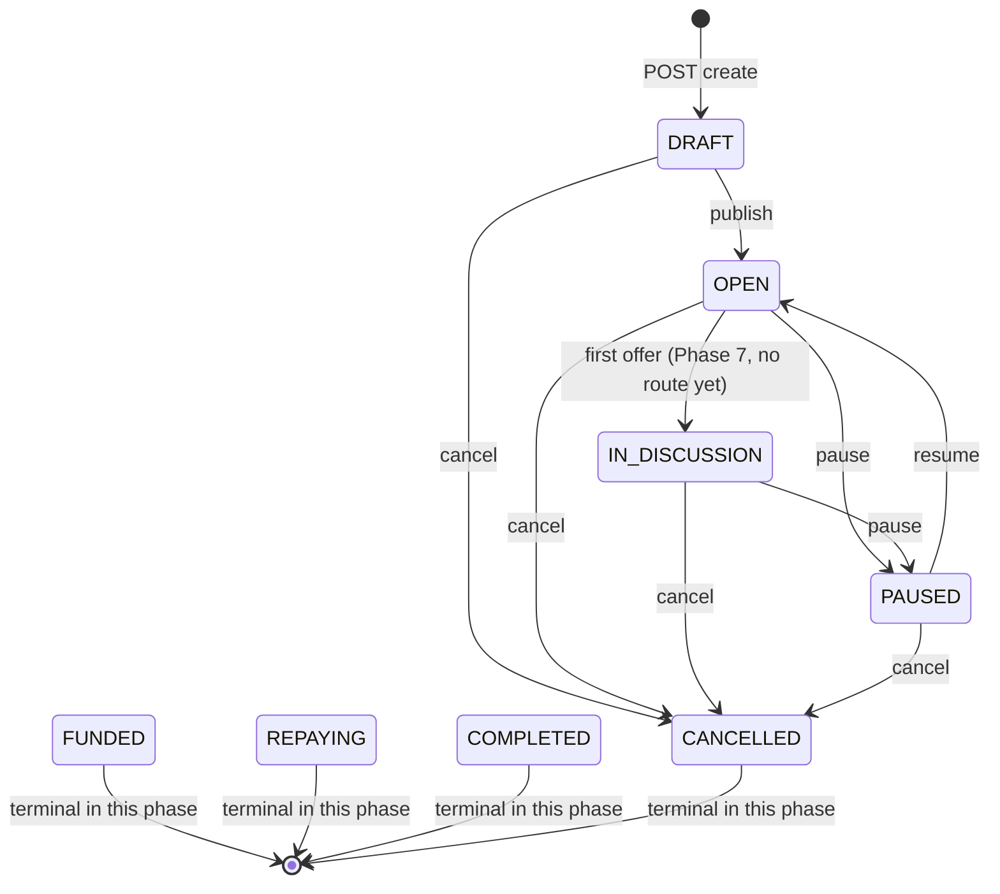

# Phase 4 — Loan requests

**Status:** Implemented in the working tree on `nahid_dev`; **not committed and not pushed**
at the time this report was written. There is no Git commit for Phase 4 yet.
**Source of truth:** current source files listed below, `docs/API.md`,
`src/server/openapi/routes/loan-requests.ts`, and the test suite.

## 1. Phase objective

Implement the loan-request lifecycle and API: OWNER-created drafts, explicit publish/pause/
resume/cancel actions, the one-active-request rule, owner-scoped management, public discovery
of OPEN requests, and OpenAPI/API documentation — without implementing offers, agreements,
loans or repayments.

## 2. Implemented features

- Create a `DRAFT` request; list and read the authenticated OWNER's own requests (all
  statuses); update eligible requests.
- Explicit actions only: publish, pause, resume, cancel. No generic `status` updates.
- Verification, profile-completeness and one-active-request gating for publish/resume.
- Automatic `LOAN_REQUEST` feed post on publish/resume; soft-delete on pause/cancel; all in
  the same transaction as the status change.
- Public cursor-paginated listing of `OPEN` requests with filters and sorting; public detail
  that returns 404 for non-OPEN requests.
- Explicit response allow-lists for owner and public views; no private account or internal
  data in public responses.
- OpenAPI registration and `docs/API.md` contract updates.

## 3. Files created and modified

Created:

- `src/server/services/loan-request.ts`
- `src/server/services/loan-request.test.ts` (31 tests)
- `src/server/validators/loan.test.ts` (24 tests)
- `src/server/openapi/routes/loan-requests.ts`
- `src/app/api/v1/me/loan-requests/route.ts`
- `src/app/api/v1/me/loan-requests/[id]/route.ts`
- `src/app/api/v1/me/loan-requests/[id]/publish/route.ts`
- `src/app/api/v1/me/loan-requests/[id]/pause/route.ts`
- `src/app/api/v1/me/loan-requests/[id]/resume/route.ts`
- `src/app/api/v1/me/loan-requests/[id]/cancel/route.ts`
- `src/app/api/v1/loan-requests/route.ts`
- `src/app/api/v1/loan-requests/[id]/route.ts`

Modified:

- `src/server/validators/loan.ts` — filters, sort schema, owner/public response allow-lists
- `src/server/openapi/schemas.ts`, `src/server/openapi/routes/index.ts`,
  `src/server/openapi/openapi.test.ts`
- `src/server/auth/proxy-policy.test.ts`
- `docs/API.md`

## 4. Database models and migrations involved

- Uses the Phase 1 `LoanRequest` and `Post` models unchanged.
- No Prisma schema change and **no migration required**. Concurrency safety for the
  one-active-request rule uses the existing partial unique index from
  `prisma/migrations/20261123170000_init/migration.sql`:
  `CREATE UNIQUE INDEX "loan_request_one_active_per_owner" ON "loan_request"("ownerId")
  WHERE (status IN ('OPEN', 'IN_DISCUSSION', 'FUNDED', 'REPAYING'));`
- Also reads `UserVerification` (APPROVED gate and public verified badge) and
  `BusinessProfile` (profile-completeness gate and public mini-profile).
- No `prisma db push`, reset, or migration command was run for Phase 4.

## 5. API endpoints, methods, authentication and authorization

| Method | Path | Authentication | Authorization |
|---|---|---|---|
| GET | `/api/v1/me/loan-requests` | Session cookie | OWNER only; own requests only |
| POST | `/api/v1/me/loan-requests` | Session cookie | OWNER only; `ownerId` is the session user |
| GET | `/api/v1/me/loan-requests/{id}` | Session cookie | OWNER + ownership check |
| PATCH | `/api/v1/me/loan-requests/{id}` | Session cookie | OWNER + ownership; DRAFT or PAUSED only |
| POST | `/api/v1/me/loan-requests/{id}/publish` | Session cookie | OWNER + ownership; DRAFT only |
| POST | `/api/v1/me/loan-requests/{id}/pause` | Session cookie | OWNER + ownership; OPEN or IN_DISCUSSION |
| POST | `/api/v1/me/loan-requests/{id}/resume` | Session cookie | OWNER + ownership; PAUSED only |
| POST | `/api/v1/me/loan-requests/{id}/cancel` | Session cookie | OWNER + ownership; DRAFT/OPEN/IN_DISCUSSION/PAUSED |
| GET | `/api/v1/loan-requests` | None (public) | OPEN requests only; safe fields only |
| GET | `/api/v1/loan-requests/{id}` | None (public) | 404 unless OPEN |

Owner paths live under the proxy-protected `/api/v1/me` prefix; public paths are deliberately
unprotected. All responses use `{ data, meta? }` and standard error codes
(400/401/403/404/409/422).

## 6. Business rules and state transitions

Allowed service-layer transitions (anything else → 409 `CONFLICT`):

Each action additionally enforces its own source state, so `resume` cannot be used from
`DRAFT` even though both `publish` and `resume` target `OPEN`.

Other rules:

- One active request per OWNER across `OPEN`, `IN_DISCUSSION`, `FUNDED`, `REPAYING`;
  service pre-check plus DB partial unique index, with concurrent `P2002` mapped to 422.
- Publish/resume require APPROVED OWNER verification (403), a complete business profile and
  no other active request (422).
- Only DRAFT and PAUSED requests are editable.
- Money is positive whole-taka `Int`; rate is `Decimal(5,2)` normalized to strings like
  `"14.50"`; tenure 1–3650 days; up to 10 HTTP(S) proof URLs.
- Public list filters: `category`, `district`, `minAmountBdt`, `maxAmountBdt`,
  `maxTenureDays`, `frequency`, `sort` (`newest` | `amountAsc` | `amountDesc`); cursor
  pagination defaults to 20 and caps at 50. Inverted ranges are rejected with 400.
- No funding is calculated or promised. No offer, agreement, loan or repayment is created.

## 7. Validation and security measures

- Strict Zod inputs reject `ownerId`, `status`, `publishedAt`, `trustScore`, `id` and any
  other client-supplied server-controlled field.
- Services re-parse inputs with the same Zod schemas (defense in depth) and re-check role,
  ownership and verification rather than trusting route guards alone.
- Prisma transactions wrap status changes and feed-post writes; multi-table writes are never
  split.
- Public responses are explicit allow-lists: no `ownerId`, `proofUrls`, `status`,
  `updatedAt`, email, phone, verification records or internal file IDs. Public requests are
  OPEN, so `status` is intentionally omitted.
- Owner detail responses contain the full request but never another user's data.

## 8. Tests and verification results

- `src/server/services/loan-request.test.ts` — 31 tests: role restrictions, ownership,
  missing resources, verification gating, profile gating, duplicate active requests,
  concurrent unique-index conflict (422), every allowed/rejected transition, feed-post
  lifecycle, cursor pagination, filters (including min+max together), public sanitization
  and verified badges.
- `src/server/validators/loan.test.ts` — 24 tests: rate normalization, integer BDT, invalid
  enums, server-controlled field rejection, query filters/sort/ranges, and response
  allow-lists.
- OpenAPI and proxy-policy tests extended for Phase 4 paths.
- Full verification run passes: `pnpm lint`, `pnpm typecheck`, `pnpm test`
  (271 tests / 24 files), `pnpm build` (all Phase 4 routes appear in the route table),
  `git diff --check`.

## 9. Known limitations or incomplete work

- `OPEN → IN_DISCUSSION` is a legal transition but has **no route** in this phase; it will be
  triggered by the first offer in Phase 7.
- Publishing creates only the auto-generated `LOAN_REQUEST` feed post; general post CRUD,
  likes and comments belong to Phase 5.
- Public list filtering is case-insensitive **exact** match on category/district, not fuzzy
  search; discovery/search endpoints are Phase 5.
- No notification emails on publish/pause/resume/cancel (notification types are Phase 9).
- Feed-post `content` is a generated summary; there is no owner-authored announcement text.
- No concurrency load test against a live Postgres instance; the unique-index race is
  covered by a simulated `P2002` unit test.
- Phase 4 changes are uncommitted; they must be reviewed and committed before release.

## 10. Dependencies on other phases

- Depends on Phase 1 (`LoanRequest`, `Post`, partial unique index), Phase 2 (session/role/
  verification guards, error envelope) and Phase 3 (`BusinessProfile` gate and public
  mini-profile).
- Phase 5 will read the auto-created feed posts in the feed.
- Phase 7 will drive `OPEN → IN_DISCUSSION` when the first offer arrives, then `FUNDED` on
  acceptance.
- Phase 8 will drive `REPAYING`/`COMPLETED` and Phase 9 will add notifications and reviews.
